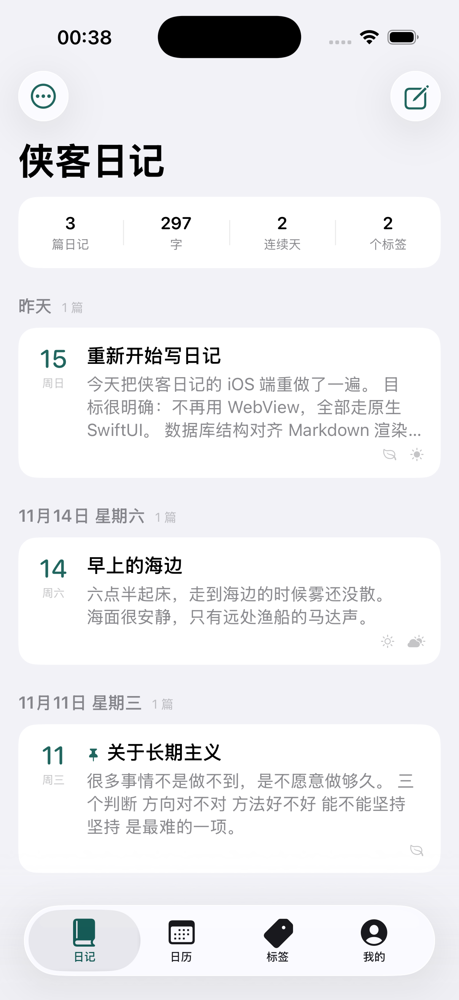
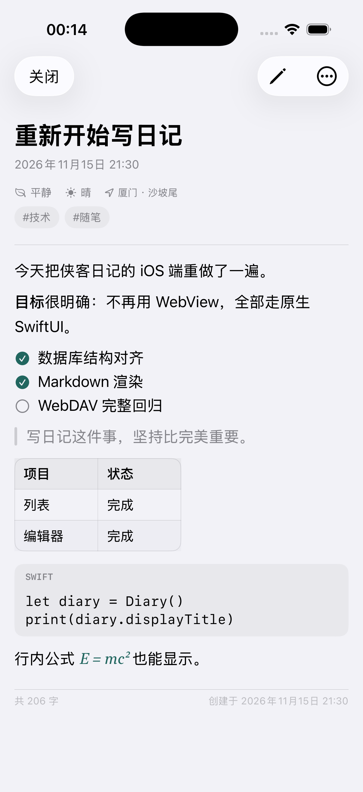
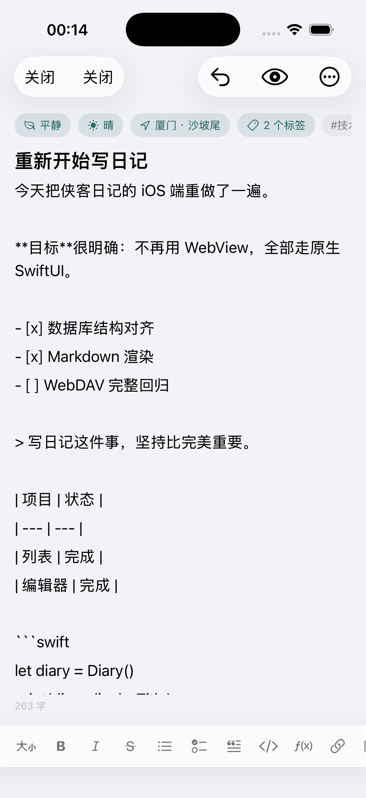
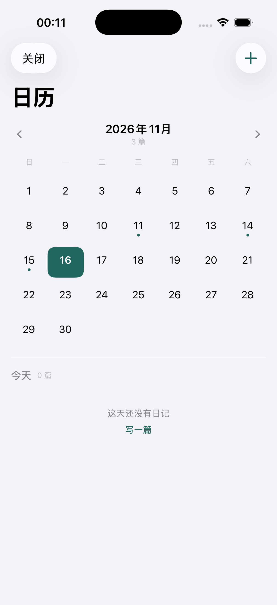
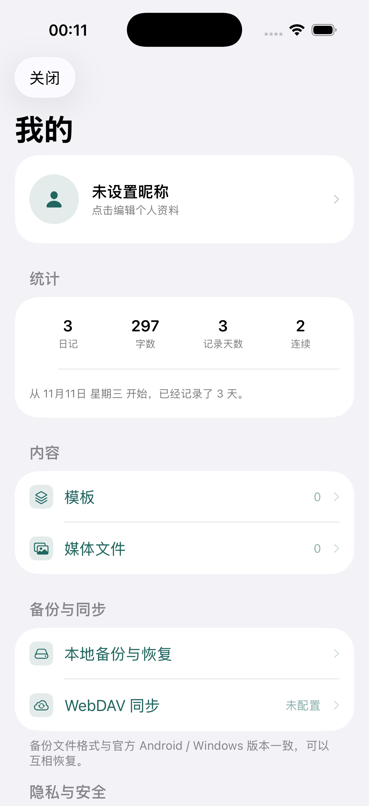
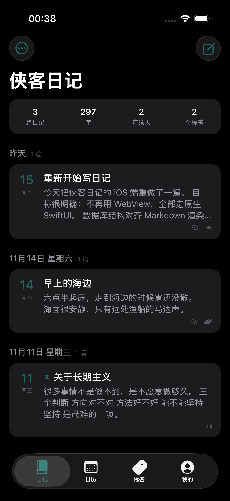

# 侠客日记 · iOS 原生版

> **用 SwiftUI 把原项目的 iOS 端从「没人维护的 WebView 套壳」重做成一个真正的原生应用。**
>
> 这不是 fork，不是上游的一个分支，也不是换皮。它复用原项目的**数据格式**与**交互理念**，
> 代码与界面 100% 重新实现，技术方向与原项目完全不同。

原项目：[Yu-Core/SwashbucklerDiary](https://github.com/Yu-Core/SwashbucklerDiary)（Blazor Hybrid + .NET MAUI，AGPL-3.0）

---

## 为什么会有这个项目

原项目的 iOS 端长期没有有效维护，而且它本质上只是把 Blazor 页面塞进 `BlazorWebView`：
`src/SwashbucklerDiary.Maui/Platforms/iOS/` 下只有两个文件、不到 60 行的启动样板。
它没有 `NavigationStack`，没有原生手势，没有系统分享，编辑器是跑在 WebView 里的 Vditor（约 20 MB JS）。

所以这里做的是**复活**，而不是修补：

| | 原项目 iOS | 本项目 |
| --- | --- | --- |
| 语言 | C# / Razor | Swift |
| UI 框架 | Blazor Hybrid（WebView） | SwiftUI |
| 数据库 | SQLSugar ORM | 系统 `sqlite3`（同一份表结构） |
| 编辑器 | Vditor + WebView | 原生 `UITextView` + 自研 Markdown 引擎 |
| 网络 | `WebDav.Client` | `URLSession` + 后台传输 |
| 构建 | 无 iOS CI | GitHub Actions + 单元测试 + IPA 打包 |

**唯一刻意保持一致的是数据。** 表名、列名、字段类型、备份 zip 的内部结构、正文里的资源 URI
全部对齐原项目，所以老用户的日记和备份可以零转换直接搬过来，导出的备份官方 Android / Windows 端也认。
这是这个项目存在的技术前提——否则所谓「复活」就是让用户重写一遍日记。

**本仓库只包含 iOS 原生实现。** 原来的 .NET 跨平台工程（Android / Windows / macOS / Linux / Web）
不在这个仓库里，请到[上游仓库](https://github.com/Yu-Core/SwashbucklerDiary)获取。两边可以并存：
共用备份格式，互不干扰。

## 界面

| 时间线 | 详情 | 编辑器 |
| --- | --- | --- |
|  |  |  |

| 日历 | 我的 | 深色模式 |
| --- | --- | --- |
|  |  |  |

更多截图见 `docs/screenshots/`。

## 功能

**日记**
新建 / 编辑 / 删除 / 详情 / 四种排序 / 置顶 / 全文搜索 + 多维筛选（标签、心情、天气、时间范围、是否含附件）/ 模板 / 正文引用 / 分享

**附加信息**
标签（多对多，同名自动复用）/ 心情 / 天气 / 地点（含历史地点快选）/ 创建与修改时间

**媒体**
相册多选 / 相机 / 音频 / 视频 / 全屏预览（双指缩放）/ 媒体库分类浏览 / 引用计数 / 清理未引用文件

**Markdown**
标题、列表、任务列表、代码块（语言标签 + 行号）、引用、表格、分割线、链接、图片、
加粗斜体删除线、行内代码、行内与块级公式、脚注引用

**隐私与安全**
隐私空间（独立数据库文件，连接层隔离）/ 入口密码 / 应用锁（数字、图案、面容 ID）/ 离开自动锁定 /
PBKDF2-SHA256 加盐哈希，无明文存储

**数据**
本地备份（与原格式一致的 zip，媒体可选）/ 恢复（预检 + 失败自动回滚）/
导出 Markdown、JSON、TXT、CSV / WebDAV 上传与恢复

**界面**
Liquid Glass（iOS 26 原生 `glassEffect`，旧系统自动降级为材质）/ 深浅色 / 动态字体 /
安全区域 / iPhone 全尺寸适配

## 数据兼容

这一点是这个项目的底线，单独说明：

- **直接读原库**：表名 `DiaryModel` / `TagModel` / `DiaryTagModel` / `ResourceModel` /
  `DiaryResourceModel` / `LocationModel` 等，列名与 SQLSugar CodeFirst 输出一致。
- **宽松读取**：日期兼容 10 种布局 + Unix 时间戳 + .NET Ticks；Guid 兼容带花括号、大写、去连字符三种写法；
  老库缺 `Template` / `Private` / `Top` 列时启动自动补齐。
- **备份互通**：`SwashbucklerDiaryBackup_<时间>_v<版本>.zip`，内含
  `SwashbucklerDiary.db3` + `settings.json` + `version.json` + `appdata/{Image,Audio,Video,Avatar}`。
  连原项目 `settings.json` 里 `RigthOutline` 这个拼写错误都保留了。
- **旧格式兼容**：没有 `version.json` 的备份，自动搬运 `Image/` 并改写正文里的 `appdata:///`。

迁移路径与字段级策略见 [`docs/DATA_MIGRATION.md`](docs/DATA_MIGRATION.md)。

## 快速开始

```bash
git clone https://github.com/zrtnb6/SwashbucklerDiary.git
cd SwashbucklerDiary/ios
open SwashbucklerDiary.xcodeproj
# 选自己的 Team，Cmd+R
```

要求 **Xcode 16.4+**（iOS 18.5 SDK 即可编译；Xcode 26+ 才会启用 Liquid Glass，旧版本自动降级）。
部署目标 iOS 17.0。

**没有任何第三方依赖**：不需要 xcodegen、CocoaPods、SPM，工程文件随仓库提供，
新增 Swift 文件放进目录就会被自动纳入编译（用的是 Xcode 的同步目录组）。

跑测试：

```bash
cd ios
xcodebuild -project SwashbucklerDiary.xcodeproj -scheme SwashbucklerDiary \
  -destination 'platform=iOS Simulator,name=iPhone 16 Pro' test
```

```
Executed 54 tests, with 0 failures (0 unexpected)
```

其中 13 个 WebDAV 用例跑在**进程内模拟服务器**上（`Tests/LocalWebDAVServer.swift`，基于 `NWListener`），
不需要真实账号就能验证建目录、鉴权、中文文件名、8 MB 大文件、重复覆盖、服务器错误、上传后恢复。

## 构建与发布

`.github/workflows/ios-build.yml`：

- push / PR 到 `main`：Release 编译 + 单元测试，上传 `.app` 与测试日志
- 手动触发：额外打包**未签名 IPA**
- 配置签名 Secrets 后：额外产出**已签名 IPA**

未签名 IPA 不能直接安装，需要用 AltStore / Sideloadly / Xcode 自己的证书重签。
部署与签名细节见 [`docs/BUILD_GUIDE.md`](docs/BUILD_GUIDE.md)。

## 项目结构

```
ios/
├── SwashbucklerDiary.xcodeproj      手写的 pbxproj（同步目录组）
├── Support/Info.plist
├── SwashbucklerDiary/
│   ├── App/          入口、根视图、Debug 页面直达
│   ├── Core/         SQLite 封装、兼容解析、ZIP、日志、设计系统
│   ├── Models/       实体与枚举
│   ├── Persistence/  Schema、连接管理、四个仓储
│   ├── Services/     设置、状态、备份、媒体、Markdown、WebDAV、安全
│   ├── Features/     14 个页面
│   └── Resources/    Assets
└── Tests/            4 个测试文件 + 1 个模拟服务器
docs/                 6 份文档 + 验收截图
.github/workflows/    iOS 构建流程
```

架构决策与取舍见 [`docs/IOS_ARCHITECTURE.md`](docs/IOS_ARCHITECTURE.md)。

## 文档

| 文档 | 内容 |
| --- | --- |
| [IOS_REWRITE_PLAN.md](docs/IOS_REWRITE_PLAN.md) | 对原项目真实代码的审计结论 + 逐项功能迁移清单（含未实现项与原因） |
| [IOS_ARCHITECTURE.md](docs/IOS_ARCHITECTURE.md) | 分层、并发模型、编辑器实现、Markdown 引擎、取舍说明 |
| [DATA_MIGRATION.md](docs/DATA_MIGRATION.md) | 数据库结构映射、字段级兼容策略、导入流程与回滚 |
| [WEBDAV_FIXES.md](docs/WEBDAV_FIXES.md) | 15 类上传缺陷的根因与修复、测试矩阵 |
| [TEST_REPORT.md](docs/TEST_REPORT.md) | 54 个用例结果、测试中发现并修掉的缺陷、UI 验收记录 |
| [BUILD_GUIDE.md](docs/BUILD_GUIDE.md) | 本地构建、CI、IPA 打包与签名、常见问题 |

## 已知限制

- **只有简体中文**。原项目 20+ 语言词表没有迁移，`AppSettings.language` 字段已保留。
- **数学公式是近似排版**（符号替换 + 上下标），不是完整 LaTeX；原始源码可复制。
- **表格导出用 CSV** 代替 xlsx（无第三方表格库；XLSX 本质是 zip + XML，后续可补）。
- **日记合并**的业务方法已实现，缺多选 UI。
- **局域网传输、成就系统 UI** 未实现。
- 只支持 iOS。Android / Windows / macOS / Web 请用原项目。

逐项原因与后续路径见 `docs/IOS_REWRITE_PLAN.md` 第六节。

## 许可与致谢

本项目遵循 **AGPL-3.0**（见 [LICENSE.txt](LICENSE.txt)），与原项目一致。
它基于原项目的数据库结构、备份格式与交互设计重新实现，属于衍生作品，因此沿用同一许可。

感谢 [Yu-Core](https://github.com/Yu-Core) 与所有贡献者做出的原项目。
没有那份扎实的数据模型和克制的产品设计，这个 iOS 版本没有存在的基础。

原项目地址：https://github.com/Yu-Core/SwashbucklerDiary
